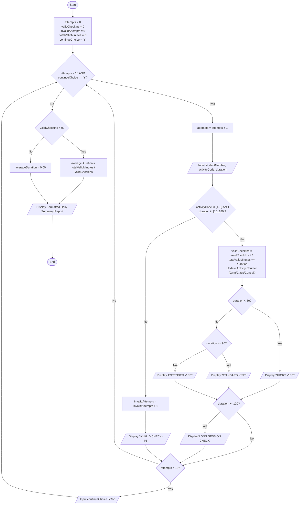
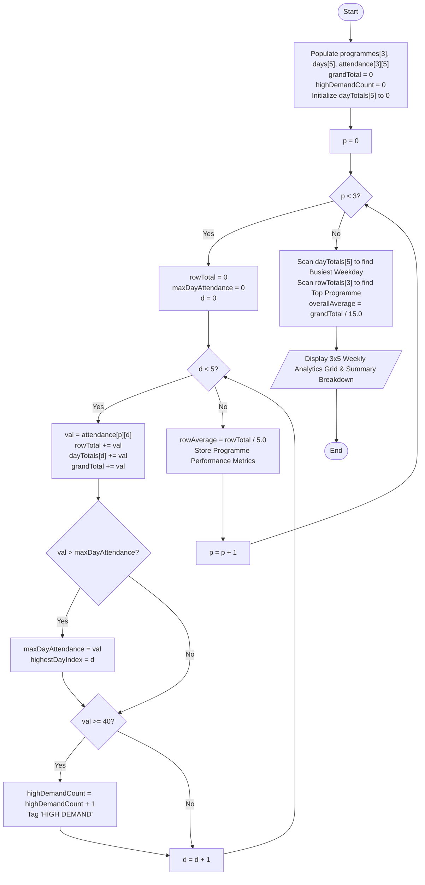

# ITPPA-Formative-Mowbray-EDUV4976773

# Overview

The VukaFit Campus Wellness Management System is a modular C++ program built on the principles of procedural programming to help modernise the administrative and analytical workflows of the VikaFit Campus Wellness Centre. This system replaces the manual methods of tracking, such as spreadsheets and paper forms, with four distinct procedural programs:
1. Membership Quotation(VukaFit_Quotation.cpp): This calculates the quotation by using selection structures to validate membership tiers, discounts, durations and optional assessments.
2. Booking Modules(Booking_Modules.cpp): A small group fitness booking system broken down into seven modular functions with value returning and reference parameters.
3. Check-In Porcessor(VukaFit_CheckIn.cpp): An attendance tracker which is loop-driven. It records daily visits, validates input rules, puts session lengths into categories and monitors the duration limits as well as computing statistics without division-by-0 errors.
4. Attendance Analytics (VukaFit_Analytics): An analytics program for processing a 3 by 5 multi-dimensional array to obtain weekly program totals, daily averages, peak days busiest weeks and high demand session alerts

# Program Design, Implementation and Testing

## Question 1: Membership Quotation

### 1.1 Membership Quotation Input, Processing and Output Chart

| Input | Processing | Output |
| :--- | :--- | :--- |
| • `studentNumber` (`string`) • `studentName` (`string`) • `membershipCode` (`int`) • `months` (`int`) • `assessmentChoice` (`char`) | 1. Prompt and read student credentials (`studentNumber`, `studentName`). 2. Prompt for `membershipCode` (1 to 3): &nbsp;&nbsp;&nbsp;&nbsp;• If < 1 or > 3, display error and terminate. &nbsp;&nbsp;&nbsp;&nbsp;• If valid, map tier: 1 = R220, 2 = R350, 3 = R480. 3. Prompt for `months` (1 to 6): &nbsp;&nbsp;&nbsp;&nbsp;• If < 1 or > 6, display error and terminate. 4. Calculate `subtotal = monthlyRate * months`. 5. Determine commitment discount rate: &nbsp;&nbsp;&nbsp;&nbsp;• If `months == 6`: discount rate = 12% &nbsp;&nbsp;&nbsp;&nbsp;• Else if `months >= 3`: discount rate = 7% &nbsp;&nbsp;&nbsp;&nbsp;• Else: discount rate = 0% 6. Prompt for `assessmentChoice` ('Y'/'N'): &nbsp;&nbsp;&nbsp;&nbsp;• If 'Y' or 'y', `assessmentFee = 180.00`; else `0.00`. 7. Compute `finalAmount = subtotal - discount + assessmentFee`. | • Quotation header • Student Number and Name • Membership tier name • Number of months • Monthly fee (R) • Subtotal (R) • Discount amount (R) • Assessment fee (R) • Final amount due (R) • Error messages for invalid inputs |

### 1.2 Membership Quotation Algorithm and Pseudocode

Module main()

    // Constant Declarations
    Constant Real BASIC_ACCESS = 220.00
    Constant Real ACTIVE_PLUS = 350.00
    Constant Real COMPLETE_WELLNESS_RATE = 480.00
    Constant Real DISCOUNT_3_TO_5_MONTHS = 0.07
    Constant Real DISCOUNT_6_MONTHS = 0.12
    Constant Real ASSESSMENT_FEE = 180.00

    // Variable Declarations
    Declare String studentNumber, studentName, selectedMembershipPlanName
    Declare Integer membershipChoice, membershipDuration
    Declare Character include_assessment
    Declare Real initialMonthlyRate, membershipSubtotal, discountRate
    Declare Real discountAmount, assessmentCharge, fullAmountDue

    // Input Student Details
    Display "Please enter your Student Number: "
    Input studentNumber
    Display "Please enter your full name: "
    Input studentName

    // Plan Selection
    Display "Please select a Plan (1: Basic, 2: Active Plus, 3: Complete Wellness): "
    Input membershipChoice

    Select membershipChoice
        Case 1:
            Set selectedMembershipPlanName = "Basic Access"
            Set initialMonthlyRate = BASIC_ACCESS
        Case 2:
            Set selectedMembershipPlanName = "Active Plus"
            Set initialMonthlyRate = ACTIVE_PLUS
        Case 3:
            Set selectedMembershipPlanName = "Complete Wellness"
            Set initialMonthlyRate = COMPLETE_WELLNESS_RATE
        Default:
            Display "Error: You have entered an invalid membership code"
            Exit Module
    End Select

    // Duration Input and Validation
    Display "May you select the duration you'd like to sign up for (1-6): "
    Input membershipDuration

    If membershipDuration < 1 Or membershipDuration > 6 Then
        Display "Error: Duration must be between 1 and 6 months"
        Exit Module
    Else
        Set membershipSubtotal = initialMonthlyRate * membershipDuration
    End If

    // Discount Calculation
    If membershipDuration == 6 Then
        Set discountRate = DISCOUNT_6_MONTHS
    Else If membershipDuration >= 3 Then
        Set discountRate = DISCOUNT_3_TO_5_MONTHS
    Else
        Set discountRate = 0.00
    End If

    Set discountAmount = membershipSubtotal * discountRate

    // Optional Assessment
    Display "Would you require a fitness assessment as well? (Y/N): "
    Input include_assessment

    If ToLower(include_assessment) == 'y' Then
        Set assessmentCharge = ASSESSMENT_FEE
    Else
        Set assessmentCharge = 0.00
    End If

    // Final Total Calculation
    Set fullAmountDue = membershipSubtotal - discountAmount + assessmentCharge

    // Output Invoice Breakdown
    Display "======================= VUKAFIT MEMBERSHIP QUOTATION =========================="
    Display "Student        : ", studentName, " - ", studentNumber
    Display "Membership     : ", selectedMembershipPlanName
    Display "Months         : ", membershipDuration
    Display "Monthly Fee    : R", initialMonthlyRate
    Display "Subtotal       : R", membershipSubtotal
    Display "Discount       : R", discountAmount
    Display "Assessment     : R", assessmentCharge
    Display "FINAL AMOUNT   : R", fullAmountDue
End Module

#### 1.3. Test Execution Table
| Test Case | Scenario / Logic Tested | Inputs | Expected Output | Actual Output | Pass/Fail |
| :--- | :--- | :--- | :--- | :--- | :--- |
| **TC 1.1** | Tier 3, 6-Month Commitment with Assessment *(Mandatory Minimum Case)* | Student No: `VF1008` Name: `Thapelo Gama` Tier: `3` Months: `6` Assessment: `Y` | Tier: Complete Wellness Monthly Fee: R480.00 Subtotal: R2880.00 Discount (12%): R345.60 Assessment Fee: R180.00 Final Total: R2714.40 | Matches Expected | **Pass** |
| **TC 1.2** | Tier 2, 6-Month Commitment with Assessment *(Sample Output Verification)* | Student No: `VF1008` Name: `Thapelo Gama` Tier: `2` Months: `6` Assessment: `Y` | Tier: Active Plus Monthly Fee: R350.00 Subtotal: R2100.00 Discount (12%): R252.00 Assessment Fee: R180.00 Final Total: R2028.00 | Matches Expected | **Pass** |
| **TC 1.3** | 7% Discount Bracket Check (Tier 1, 3 Months, No Assessment) | Student No: `VF1015` Name: `Sarah Adams` Tier: `1` Months: `3` Assessment: `N` | Tier: Basic Access Monthly Fee: R220.00 Subtotal: R660.00 Discount (7%): R46.20 Assessment Fee: R0.00 Final Total: R613.80 | Matches Expected | **Pass** |
| **TC 1.4** | 0% Discount Bracket Check (Tier 2, 2 Months, No Assessment) | Student No: `VF1020` Name: `John Doe` Tier: `2` Months: `2` Assessment: `N` | Tier: Active Plus Monthly Fee: R350.00 Subtotal: R700.00 Discount (0%): R0.00 Assessment Fee: R0.00 Final Total: R700.00 | Matches Expected | **Pass** |
| **TC 1.5** | Invalid Tier Code Boundary Trapping (`code ∉ 1..3`) | Student No: `VF1030` Name: `Jane Smith` Tier: `4` | Error message: Invalid membership tier code. Immediate program termination. | Matches Expected | **Pass** |
| **TC 1.6** | Duration Boundary Trapping (`months > 6`) | Student No: `VF1035` Name: `Mike Ross` Tier: `1` Months: `7` | Error message: Duration must be between 1 and 6 months. Immediate program termination. | Matches Expected | **Pass** |

### 1.4. How to run the program

Compile using any standard C++11 compliant compiler:

GCC/MinGW (Command line method):
**g++ -std=c++11 Question1/VukaFit_Quotation.cpp -o Question1/VukaFit_Quotation.exe
./Question1/VukaFit_Quotation.exe**

Visual Studio IDE:

Press `Ctrl + Shift + B` to compile the project then `Ctrl +F5` to run it.

### Step-by-Step Instructions

1. Enter your Student Number and Full Name.

2. Choose a membership tier: 1 (Basic Access, R220/mo), 2 (Active Plus, R350/mo), or 3 (Complete Wellness, R480/mo).

3. Enter the duration in months (1 to 6):

    6 months applies a 12% discount.
    
    3–5 months applies a 7% discount.
    
    1–2 months receives no discount.

4. Enter Y or N for the optional fitness assessment (adds R180.00 if it is selected).

5. The application displays an itemized quotation invoice and exits.

### Question 2
### Program Design & Testing

#### 2.1 IPO Analysis (Input, Processing, Output)
| Input | Processing | Output |
| :--- | :--- | :--- |
| • `bookingRef` (`string`) • `sessionCode` (`int`) • `participants` (`int`) • `isSaturday` (`char`) | 1. Display session schedule via `displaySessionMenu()`. 2. Map rate and validate code via `getSessionRate(sessionCode)`: &nbsp;&nbsp;&nbsp;&nbsp;• 1 = Yoga (R75), 2 = Strength (R110), 3 = Stress (R90). 3. Validate participants (1 to 12) via a loop using `validParticipants(participants)`. 4. Calculate subtotal via `calculateSubtotal(rate, participants)`. 5. Calculate 10% group discount for ≥ 8 participants via `calculateDiscount(subtotal, participants)`. 6. Calculate 15% weekend surcharge on discounted amount via `calculateWeekendSurcharge(amountAfterDiscount, isSaturday)`. 7. Calculate final total and cost per participant. 8. Output formatted receipt via `displayBookingSummary(...)`. | • Session rate schedule • Range validation re-prompts • Formatted Booking Summary: &nbsp;&nbsp;– Booking Reference &nbsp;&nbsp;– Session Name &nbsp;&nbsp;– Number of Participants &nbsp;&nbsp;– Subtotal (R) &nbsp;&nbsp;– Group Discount (R) &nbsp;&nbsp;– Weekend Surcharge (R) &nbsp;&nbsp;– Final Total (R) &nbsp;&nbsp;– Cost per Participant (R) |

---

#### 2.2 Test Execution Table
| Test Case | Scenario / Logic Tested | Inputs | Expected Output | Actual Output | Pass/Fail |
| :--- | :--- | :--- | :--- | :--- | :--- |
| **TC 2.1** | 10 Participants + Saturday *(Brief Minimum Test Case)* | Ref: `BK101` Session: `2` (Strength, R110) Participants: `10` Saturday: `Y` | Subtotal: R1 100.00 Group Discount (10%): R110.00 Saturday Surcharge (15%): R148.50 Final Total: R1 138.50 Cost per Participant: R113.85 | Matches Expected | **Pass** |
| **TC 2.2** | 2 Participants, Weekday *(Sample Output Verification)* | Ref: `BK204` Session: `2` (Strength, R110) Participants: `2` Saturday: `N` | Subtotal: R220.00 Group Discount: R0.00 Weekend Surcharge: R0.00 Final Total: R220.00 Cost per Participant: R110.00 | Matches Expected | **Pass** |
| **TC 2.3** | 8 Participants Boundary *(Exact 10% Discount Trigger)* | Ref: `BK308` Session: `1` (Yoga, R75) Participants: `8` Saturday: `N` | Subtotal: R600.00 Group Discount (10%): R60.00 Weekend Surcharge: R0.00 Final Total: R540.00 Cost per Participant: R67.50 | Matches Expected | **Pass** |
| **TC 2.4** | 7 Participants Boundary *(No Group Discount)* | Ref: `BK307` Session: `1` (Yoga, R75) Participants: `7` Saturday: `N` | Subtotal: R525.00 Group Discount: R0.00 Weekend Surcharge: R0.00 Final Total: R525.00 Cost per Participant: R75.00 | Matches Expected | **Pass** |
| **TC 2.5** | Single Participant Lower Bound (Session 3) | Ref: `BK401` Session: `3` (Stress, R90) Participants: `1` Saturday: `N` | Subtotal: R90.00 Group Discount: R0.00 Weekend Surcharge: R0.00 Final Total: R90.00 Cost per Participant: R90.00 | Matches Expected | **Pass** |
| **TC 2.6** | Invalid Participant Count Trapping (`< 1` or `> 12` Loop) | Ref: `BK500` Session: `2` Participants: `0`, then `15`, then `4` Saturday: `N` | Displays error re-prompt repeatedly until valid. Accepts `4`. Subtotal: R440.00, Surcharge: R0.00 Final Total: R440.00, Per Person: R110.00 | Matches Expected | **Pass** |

### Question 3

### 3.2 Question 3: Flowchart (Daily Student Check-In System)

---

#### 3.3 Participant Check-in Test Table
| Test Case | Scenario / Logic Tested | Inputs | Expected Output | Actual Output | Pass / Fail |
| :--- | :--- | :--- | :--- | :--- | :--- |
| **TC 3.1** | Normal Valid Check-In (Gym Floor) | Student: `VF101` Activity: `1` Duration: `60` Continue: `N` | Valid Check-Ins: 1 Total Mins: 60 Gym Floor: 1 Average: 60.00 mins | Matches Expected | **Pass** |
| **TC 3.2** | Short Visit Boundary (< 30 mins) | Student: `VF102` Activity: `2` Duration: `20` Continue: `N` | Status: `SHORT VISIT` Valid Check-Ins: 1 Group Class: 1 Average: 20.00 mins | Matches Expected | **Pass** |
| **TC 3.3** | Long Session Check Warning (≥ 120 mins) | Student: `VF103` Activity: `3` Duration: `125` Continue: `N` | Status: `LONG SESSION CHECK` Valid Check-Ins: 1 Consultations: 1 Average: 125.00 mins | Matches Expected | **Pass** |
| **TC 3.4** | Invalid Activity Code Trapping (∉ 1..3) | Student: `VF104` Activity: `4` Duration: `45` Continue: `N` | Status: `INVALID CHECK-IN` Invalid Attempts: 1 Valid Check-Ins: 0 Average: 0.00 mins | Matches Expected | **Pass** |
| **TC 3.5** | Duration Boundary Trapping (< 15 or > 180 mins) | Student: `VF105` Activity: `1` Duration: `10` Continue: `N` | Status: `INVALID CHECK-IN` Invalid Attempts: 1 Valid Check-Ins: 0 Average: 0.00 mins | Matches Expected | **Pass** |
| **TC 3.6** | Loop Cap Termination (10 Attempts Reached) | 10 consecutive entries with Continue: `Y` | System terminates loop automatically after 10th check-in without prompting; prints Daily Summary Report. | Matches Expected | **Pass** |

### Question 4

### Program Design & Testing

#### 4.1 IPO Analysis (Input, Processing, Output)
| Input | Processing | Output |
| :--- | :--- | :--- |
| • `programmes[3]` (`string` 1D array) &nbsp;&nbsp;*("Yoga", "Strength", "Wellness Workshop")* • `days[5]` (`string` 1D array) &nbsp;&nbsp;*("Mon", "Tue", "Wed", "Thu", "Fri")* • `attendance[3][5]` (`int` 2D array) &nbsp;&nbsp;*(Pre-populated 3×5 attendance matrix)* | 1. Initialize and pre-populate arrays. 2. Traverse 2D array using nested `for` loops: &nbsp;&nbsp;&nbsp;&nbsp;• Calculate row totals and averages (`rowTotal / 5.0`). &nbsp;&nbsp;&nbsp;&nbsp;• Find the highest attendance day and count per programme. &nbsp;&nbsp;&nbsp;&nbsp;• Identify entries where `attendance >= 40`, flag with `"HIGH DEMAND"`, and increment counter. 3. Calculate column totals across all programmes for each weekday. 4. Determine the busiest weekday (highest daily total). 5. Determine the top programme (highest weekly total). 6. Calculate grand total across all 15 cells and overall average (`grandTotal / 15.0`). | • Formatted Weekly Analytics Grid: &nbsp;&nbsp;– Daily counts by programme &nbsp;&nbsp;– `"HIGH DEMAND"` indicators &nbsp;&nbsp;– Row totals and averages &nbsp;&nbsp;– Highest day per programme • Weekday summary totals (Mon–Fri) • Summary Metrics: &nbsp;&nbsp;– Busiest weekday and total &nbsp;&nbsp;– Top programme and total &nbsp;&nbsp;– Total `HIGH DEMAND` values count &nbsp;&nbsp;– Grand total attendance &nbsp;&nbsp;– Overall average attendance |

---

### 4.2 Question 4: Flowchart (Attendance Analytics)

#### 4.3 Mandatory 4-Row Test Table
| Test Case | Scenario / Logic Tested | Inputs | Expected Output | Actual Output | Pass/Fail |
| :--- | :--- | :--- | :--- | :--- | :--- |
| **TC 4.1** | **Normal Test:** Standard 3×5 Matrix Execution *(Prescribed Data)* | Pre-populated 3×5 matrix: • Yoga: 24, 31, 28, 35, 30 • Strength: 38, 42, 36, 45, 41 • Wellness: 18, 22, 25, 20, 27 | Row Totals/Avgs: – Yoga: 148 (Avg 29.60) – Strength: 202 (Avg 40.40) – Wellness: 112 (Avg 22.40) Grand Total: 462, Overall Avg: 30.80 High Demand Count: 3 | Matches Expected | **Pass** |
| **TC 4.2** | **Boundary Test:** HIGH DEMAND Threshold (`attendance >= 40`) | Matrix boundary values: • Strength Mon: 38 (`< 40`) • Strength Tue: 42 (`> 40`) • Test value set to exactly 40 | Values ≥ 40 append HIGH DEMAND label. Value 38 displays no label. Value 40 triggers HIGH DEMAND label and increments counter. | Matches Expected | **Pass** |
| **TC 4.3** | **Changed-Data Test:** Verification of Dynamic Loop Accumulation | Modified test matrix: • Yoga Mon updated: 24 → 50 • All other values unchanged | Yoga Total updates to 174 (Avg 34.80) Mon Day Total updates to 106 Grand Total updates to 488 (Overall Avg 32.53) High Demand Count updates to 4 | Matches Expected | **Pass** |
| **TC 4.4** | **Logic Test:** Highest Programme Day & Busiest Weekday Determination | Traversal across rows and columns of standard matrix | Highest Days: – Yoga: Thu (35) – Strength: Thu (45) – Wellness: Fri (27) Busiest Weekday: Thu (100) Top Programme: Strength (202) | Matches Expected | **Pass** |
 
